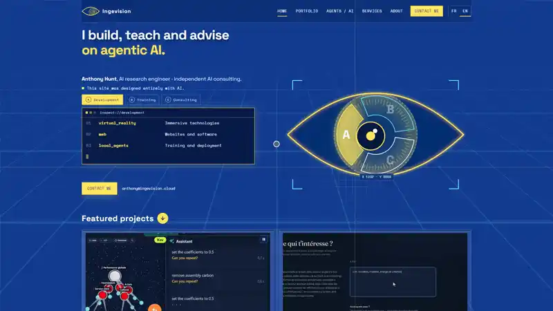
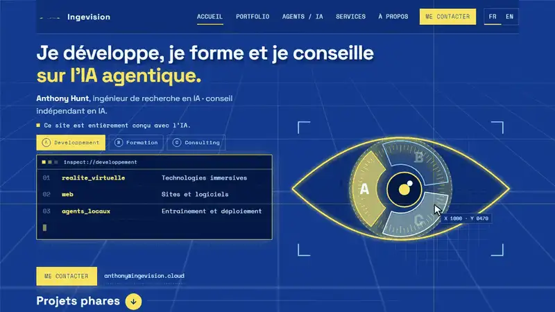

[English](README.md) · **Français**

# ingevision.cloud

**Mon site, construit et entretenu par des agents IA.** Chaque changement passe par une maquette que je valide, et six agents repassent sur le site en ligne chaque nuit.

Version française

*Accueil, Portfolio, le dépôt d'un projet, l'équipe de nuit, puis l'ouverture vue en arrivant d'un autre site. [Vidéo complète (1 min 27)](https://drive.google.com/file/d/1Va1JfjYJnmLrFipZOO_hmHsMxAhPU19T/view)*

## Utilisation

- **Accueil.** Un logo en forme d'œil suit la souris ; le zoom d'ouverture ne joue que pour un visiteur venu d'un autre site. Trois métiers : développement, formation, consulting.
- **Portfolio.** Quatre projets phares, puis 25 projets rangés dans six coffres. Un clic sur un projet ouvre son dépôt GitHub.
- **Agents / IA.** 14 agents Claude Code et un agent local, chacun avec son portrait animé et une scène de son travail. Le compteur d'usage réel de mes skills publics.
- **Services.** Cinq domaines reliés aux projets du portfolio ; quatre étapes qui se déplient.
- **Français et anglais.** Chaque écran a sa propre adresse.

## Architecture

Diagramme en français

## Exploitation

- **En ligne** depuis le 4 novembre 2026.
- **Hébergement.** Mon VPS : nginx dans Docker derrière Traefik, HTTPS, compression Brotli, politique de sécurité des contenus sans exception pour les scripts en ligne.
- **Équipe de nuit.** Accessibilité, recherche de clients, qualité, performance et sécurité, lancés l'un après l'autre entre 22 h et 4 h (Paris). Chacun corrige ce qui est factuel, le vérifie en ligne et pose le reste en questions dans le mail du matin.
- **Technologies.** HTML, CSS, JavaScript, GSAP, Python, Claude Code, Playwright.

---

**Anthony Hunt** · [ingevision.cloud](https://ingevision.cloud/) · [LinkedIn](https://www.linkedin.com/in/anthony-hunt-3948a9196) · [GitHub](https://github.com/anthohunt)

Le code du site est privé.
