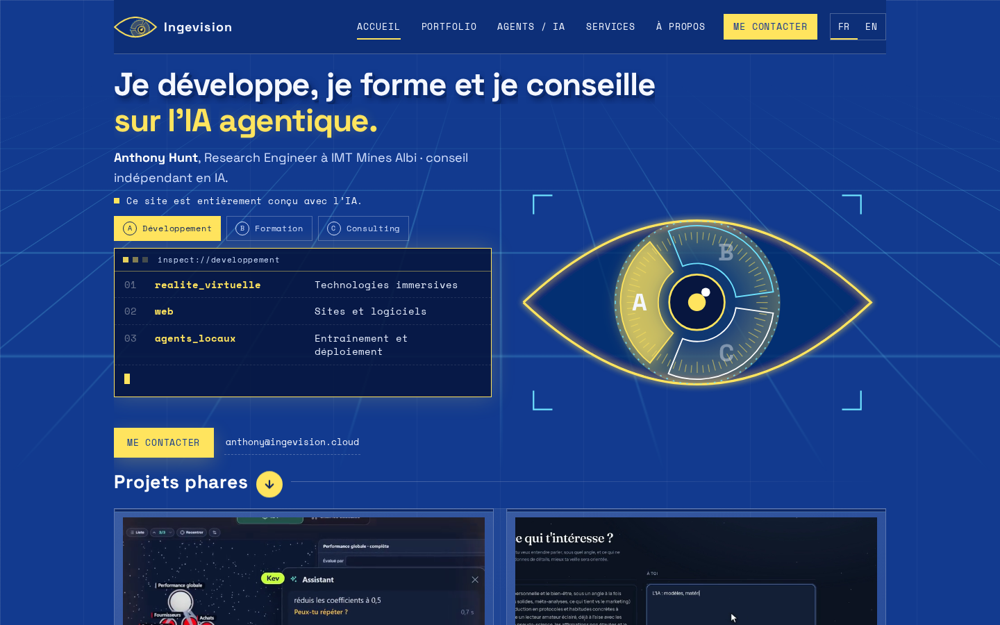

[English](README.md) · **Français**

**Anthony Hunt** · [Fiche du projet sur ingevision.cloud](https://ingevision.cloud/?p=ce-site) · [LinkedIn](https://www.linkedin.com/in/anthony-hunt-3948a9196) · [Profil GitHub](https://github.com/anthohunt)

> Dépôt vitrine : le code et les données de ce projet sont privés ; ce README le décrit.

# Ce site

Mon site personnel, conçu et construit de bout en bout par ma pipeline de création d'applications web.

## Le problème

Je veux qu'un visiteur comprenne en dix secondes ce que je sais faire : des agents IA qui tournent en production, avec la preuve que ça marche. Le site s'adresse à deux publics : un client potentiel qui arrive depuis LinkedIn et veut savoir en une minute si je peux l'aider, et un développeur d'agents IA qui veut comprendre un projet, voir son code et sa démo. C'est aussi la vitrine du chemin suivi : le site lui-même est un projet de la pipeline.

## Comment ça marche

- La pipeline web app part d'un cahier des charges : des parcours utilisateur et des user stories, validés un par un.
- Elle produit une maquette interactive dans un gabarit de revue : versions datées en haut, parcours à gauche, commentaires partagés ancrés à droite. La maquette est derrière un mot de passe.
- Un script Python assemble la page à partir de ses morceaux (corps HTML, scènes, animations, portraits des agents, user stories).
- Un script de publication fabrique le site et sa maquette et met les deux en ligne ensemble. Une nouveauté part d'abord dans la maquette seulement ; elle passe sur le site après mon accord.
- Chaque nuit, cinq agents passent sur le site l'un après l'autre : qualité (chaque user story rejouée dans un vrai navigateur, ordinateur et téléphone, chaque fiche comparée à son dépôt), performance, sécurité, et deux qui cherchent à qui le site peut servir. Ils corrigent seuls ce qui est factuel ; le reste arrive dans un mail court le matin, sous forme de questions.

## Ce qui est construit

En ligne depuis le 4 novembre 2026 sur ingevision.cloud, en français et en anglais.

- Menu : Accueil, Portfolio, Agents / IA, Services, À propos.
- Accueil : logo en forme d'œil qui suit la souris ; ouverture par un zoom dans l'œil, jouée seulement à l'arrivée depuis un autre site, qu'on peut passer d'un clic ; trois métiers (développement, formation, consulting), chacun avec sa carte ; quatre projets phares avec leur vidéo en tuile.
- Portfolio : les quatre projets phares, puis une bibliothèque de 25 projets rangés dans six coffres. Chaque fiche s'ouvre par-dessus la page, avec la description du projet et le lien vers son dépôt.
- Agents / IA : les agents qui tournent seuls, chacun avec son portrait animé et sa scène de travail ; le compteur d'utilisation réelle de mes skills publics ; les skills et outils à télécharger.
- Services : l'accompagnement de projets, cinq domaines reliés aux projets du portfolio, quatre étapes qui se déplient.
- À propos : mon parcours, mon texte et mes photos.
- Chaque écran et chaque fiche a sa propre adresse, à partager.
- Une seule charte de couleurs : bleu, jaune et blanc.

## Ce qui est public

Le site est en ligne : <https://ingevision.cloud>. Le code reste privé.

## Pile technique

- HTML, CSS et JavaScript
- GSAP 3.12.5 pour les animations
- Python pour l'assemblage des pages
- Bash et nginx pour la publication
- Agents Claude Code et Playwright pour l'entretien de nuit
