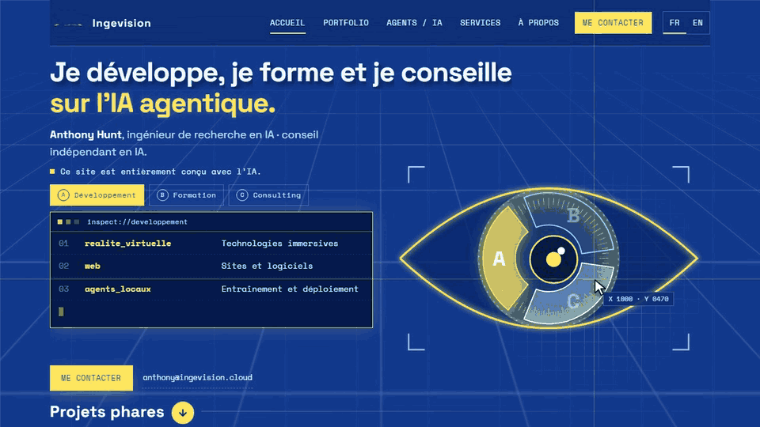

**English** · [Français](README.fr.md)

# ingevision.cloud

**My website, built and looked after by AI agents.** Every change goes through a mockup I approve, and six agents go over the live site every night.

*Home, Portfolio, a project's repository, the night team, then the opening seen when arriving from another site. [Full video (1:27)](https://drive.google.com/file/d/1dYCj_mHaxn5QUMNkSFLy1lda-ZtOutVx/view)*

## Using it

- **Home.** An eye-shaped logo follows the mouse; the opening zoom plays only for visitors coming from another site. Three activities: development, training, consulting.
- **Portfolio.** Four flagship projects, then 25 projects in six chests. A click on a project opens its GitHub repository.
- **Agents / AI.** 14 Claude Code agents and one local agent, each with an animated portrait and a scene of its work. A live count of how my public skills are used.
- **Services.** Five areas linked to portfolio projects; four steps that unfold.
- **French and English.** Every screen has its own address.

## Architecture

French version

*The demo video is in French.*

## Deployment

- **Live** since 4 November 2026.
- **Hosting.** My VPS: nginx in Docker behind Traefik, HTTPS, Brotli compression, content security policy with no inline-script exception.
- **Night team.** Accessibility, client search, quality, performance and security, starting one after the other between 22:00 and 04:00 Paris time. Each fixes what is factual, checks it online, and asks the rest in the morning email.
- **Stack.** HTML, CSS, JavaScript, GSAP, Python, Claude Code, Playwright.

---

**Anthony Hunt** · [ingevision.cloud](https://ingevision.cloud/en/) · [LinkedIn](https://www.linkedin.com/in/anthony-hunt-3948a9196) · [GitHub](https://github.com/anthohunt)

The site's code is private.
