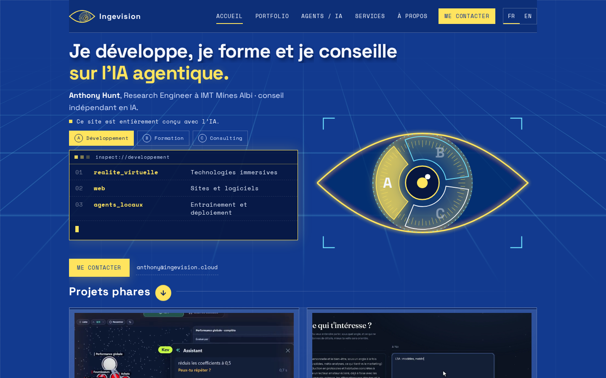

**English** · [Français](README.fr.md)

**Anthony Hunt** · [Project page on ingevision.cloud](https://ingevision.cloud/?lang=en&p=ce-site) · [LinkedIn](https://www.linkedin.com/in/anthony-hunt-3948a9196) · [GitHub profile](https://github.com/anthohunt)

> Showcase repository: the code and data of this project are private; this README describes it.

# This site

My personal website, designed and built end to end by my web app pipeline.

## The problem

I want a visitor to understand in ten seconds what I can do: AI agents running in production, with proof that they work. The site serves two audiences: a potential client arriving from LinkedIn who wants to know in one minute whether I can help, and an AI agent developer who wants to understand a project, see its code and its demo. It also shows the path taken: the site itself is a project of the pipeline.

## How it works

- The web app pipeline starts from a specification: user journeys and user stories, approved one by one.
- It produces an interactive mockup in a review template: dated versions at the top, journeys on the left, shared comments anchored on the right. The mockup sits behind a password.
- A Python script assembles the page from its parts (HTML body, scenes, animations, agent portraits, user stories).
- A publishing script builds the site and its mockup and puts both online together. A new feature first goes to the mockup only; it reaches the site once I approve it.
- Every night, five agents go over the site one after the other: quality (every user story replayed in a real browser, desktop and phone, every project page checked against its repository), performance, security, and two that look for who the site could help. They fix factual issues on their own; everything else arrives in a short morning email, as questions.

## What is built

Live since 4 November 2026 at ingevision.cloud, in French and English.

- Menu: Home, Portfolio, Agents / AI, Services, About.
- Home: an eye-shaped logo that follows the mouse; an entrance that zooms into the eye, played only when arriving from another site and skippable with one click; three activities (development, training, consulting), each with its own card; four flagship projects with their video in a tile.
- Portfolio: the four flagship projects, then a library of 25 projects sorted into six chests. Each project page opens over the page, with the project description and a link to its repository.
- Agents / AI: the agents that run on their own, each with an animated portrait and a scene of its work; a live count of how often my public skills are really used; skills and tools to download.
- Services: project support, five areas linked to portfolio projects, four steps that unfold.
- About: my background, my text and my photos.
- Every screen and every project page has its own address, to share.
- One colour scheme only: blue, yellow and white.

## What is public

The site is live: <https://ingevision.cloud>. The code stays private.

## Tech stack

- HTML, CSS and JavaScript
- GSAP 3.12.5 for animations
- Python to assemble the pages
- Bash and nginx for publishing
- Claude Code agents and Playwright for the nightly upkeep
